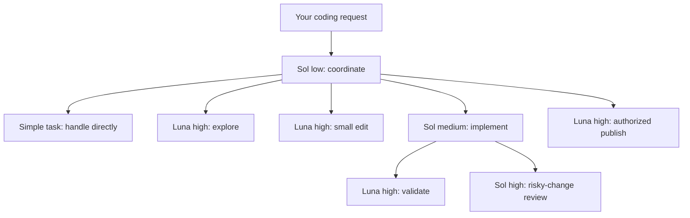

# Model map

Verified against official documentation and the installed Codex catalog on 2026-10-20.

Sol handles ambiguity and integration; Luna handles clear bounded work. Validation
is independent of implementation when useful. Review focuses on concrete risks.
This is a reasoned starting policy, not an empirical claim that these settings are
universally optimal. Compare actual success, latency and usage on your own tasks.
Avoid running six agents for a one-line fix.

The coordinator defaults to Sol / low. `--quality deep` selects Sol / high.
`--quality frontier` explicitly selects Astra / low for exceptionally difficult work.
Astra is never automatically launched by a role. Edit `.relay/models.json` in the
TARGET repository to change session policies. Edit that target's
`.codex/agents/relay_*.toml` for worker settings. Both model and effort must be supported.
Editing the `roles` summary in models.json does not rewrite role TOMLs; TOMLs are
the authoritative worker settings. Source defaults for future installs live in
`models.json` and `agents/` in this repository.

Keep customized files: the installer intentionally refuses to overwrite local edits.
Run doctor after changes. A catalog listing does not prove account access. Update
retired model names rather than silently substituting one.

Sources: [Official model guidance](https://learn.chatgpt.com/docs/models),
[custom agents and model/effort precedence](https://learn.chatgpt.com/docs/agent-configuration/subagents),
[configuration reference](https://learn.chatgpt.com/docs/config-file/config-reference).
