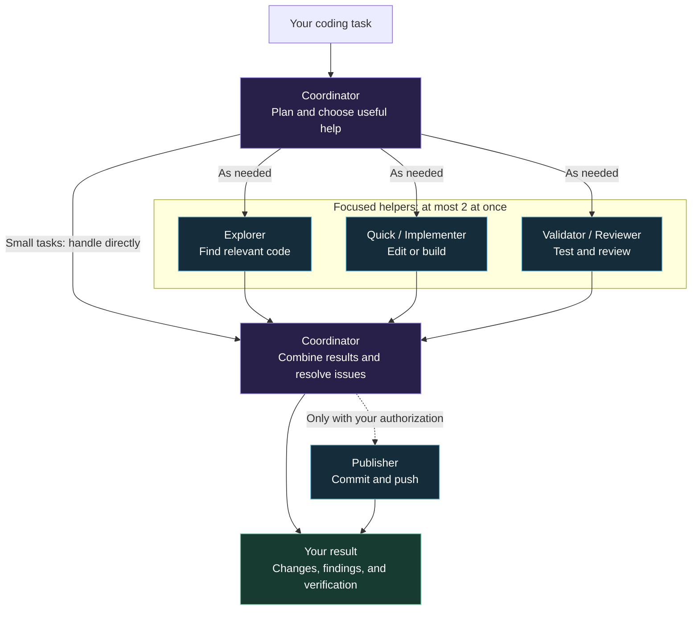

# Partition Code

Partition Code configures coding agents for Codex. One coordinator handles your
request and can ask focused helpers to explore code, make changes, run checks, or
review the result. Small fixes usually stay in the main conversation.

The project grew out of a recurring question: which model is worth using for this
particular task? The setup takes inspiration from
[subagents_configs](https://github.com/nsEytgXm/subagents_configs), with its own
routing rules and project-scoped installer. Writing references are handled separately
by [Partition Writing](https://github.com/3nboyd/partition-writing).

## How the orchestrator works

You describe the outcome. The coordinator keeps track of the whole task, chooses
focused help when useful, and brings the work back together into one answer.



For example, a bug fix might use an **Explorer** to locate the cause, an
**Implementer** to fix it, and a **Validator** to check the result. The coordinator
waits for dependent work and integrates the findings; it does not launch every role
for every request. A small, obvious fix can stay entirely with the coordinator.

All workers share the project checkout and inherit the session's permissions.
The coordinator assigns nonoverlapping file ownership when work runs in parallel.
Partition Code installs these roles and routing rules into your project; Codex runs
the session. See [ROUTING.md](ROUTING.md) for the delegation rules and
[MODEL_MAP.md](MODEL_MAP.md) for the configured models.

## Get started

Requires Python 3.11+, Git, and Codex CLI. Sign in with `codex login`, then run:

```sh
git clone https://github.com/3nboyd/partition-code.git
cd partition-code
python3 relay.py install --project /path/to/your/code
python3 relay.py doctor --project /path/to/your/code --check-models
python3 relay.py run --project /path/to/your/code
```

The commands above perform three steps:

1. `install` adds the project agents and configuration to your coding folder.
2. `doctor --check-models` checks the installation and configured model names.
3. `run` opens a coding session for that folder.

Replace `/path/to/your/code` with the folder you want to work on. Ask for the change,
investigation, or review in the session that opens. The launcher
registers the project agents and applies the model settings without changing global
Codex configuration. Existing chats may need to be restarted to discover new agents.

### On a Mac

Run `python3 install_macos.py` to add **Partition Code** to your Applications folder.
This requires Apple Command Line Tools (`xcode-select --install`). Installing the
Mac app creates a launcher; it does not choose or configure a coding project yet.

Open **Partition Code**, choose a coding folder, and continue in the Terminal session
it starts. The launcher adds the project agents to that folder before opening
Codex. If existing files conflict, it stops and preserves them.

Keep this cloned repository in place; the Mac launcher runs the code from that copy.

## Model map

| Work | Role | Model / effort |
| --- | --- | --- |
| Planning and integration | Coordinator | GPT-6.1 Sol / low |
| Repository discovery | relay_explorer | GPT-6 Luna / high |
| Small, clear edits | relay_quick | GPT-6 Luna / high |
| Larger features and fixes | relay_implementer | GPT-6.1 Sol / medium |
| Independent checks | relay_validator | GPT-6 Luna / high |
| Changes needing closer review | relay_reviewer | GPT-6.1 Sol / high |
| Authorized commits and pushes | relay_publisher | GPT-6 Luna / high |

These are starting defaults. [MODEL_MAP.md](MODEL_MAP.md) explains the choices and
how to change them; [ROUTING.md](ROUTING.md) describes when each role is useful.
The launcher allows two workers at once. Workers share the checkout and inherit
the parent session's permissions, so file ownership still matters.

## Permissions

New installations inherit Codex's permission settings. Choose the access you want
for new sessions from this Partition Code installation:

| Mode | Behavior |
| --- | --- |
| `inherit` | Keep Codex's existing permission settings; this is the default. |
| `workspace` | Use a workspace sandbox with interactive execution approvals. |
| `auto-review` | Use a workspace sandbox with eligible approvals handled by Codex's automatic reviewer. |
| `full` | Allow filesystem and network access without execution approval prompts; use for trusted work. |

Save a choice, for example:

```sh
python3 relay.py configure --permissions full
```

`full` uses `--ask-for-approval never --sandbox danger-full-access`. The saved choice
applies to new sessions from the Mac app and CLI. An already-running session keeps
its settings; use `/permissions` there or reopen Partition Code to change them.

Override one session with `run --permissions MODE`. Saved preferences are local to
this installation and do not change global Codex settings or Partition Writing.

Workers inherit the parent's permissions. Routine implementation choices should
proceed without questions; missing requirements or consequential design decisions
can still need input. Account logins and host or connector requirements still apply.
`--read-only` always starts a read-only session, even if full access is saved.

[Official approval and permission settings](https://learn.chatgpt.com/docs/agent-approvals-security).

## Common commands

```sh
python3 relay.py run --project /path/to/code --read-only "Analyze the authentication flow"
python3 relay.py run --project /path/to/code --quality deep "Investigate this intermittent failure"
python3 relay.py run --project /path/to/code --dry-run "Explain the test failure"
python3 relay.py run --project /path/to/code --exec "Fix the parser and run its tests"
python3 relay.py uninstall --project /path/to/code
```

`--read-only` applies to the whole session. `--quality deep` increases the
coordinator's reasoning effort; `frontier` explicitly selects Astra. Worker
models are configured separately in their TOML files.

The installer adds a section to AGENTS.md and files under `.relay/` and
`.codex/agents/`. It preserves unrelated configuration and modified managed files.
Uninstall removes its own files and retains local edits.

Codex access and usage limits come from the signed-in account. This project
currently supports Codex. [SETUP_FOR_AGENTS.md](SETUP_FOR_AGENTS.md) provides
instructions for another assistant setting it up.

## Development

```sh
python3 -m unittest discover -s tests -v
python3 scripts/check_public.py
```

CI runs on Python 3.11 and 3.13. Mac launcher compilation is checked on macOS.
